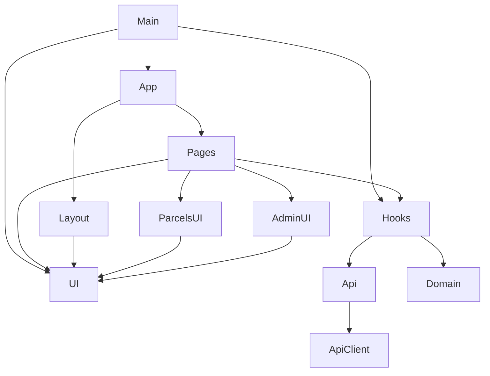

# parcelFlow_Frontend — Architecture

## 1. Stack
- TypeScript, React 19, React Router 7 (source: package.json)
- Vite 6 build/dev server; `@tailwindcss/vite` + Tailwind CSS 4 (package.json)
- TanStack React Query 5 for server-state; Zod for validation (package.json)
- Static SPA, no backend of its own — talks to a separate ParcelFlow API over HTTPS (README.md)

## 2. Directory map

| path | what lives there |
|---|---|
| index.html | HTML shell; loads `/src/main.tsx`; pre-paint dark-mode script |
| src/main.tsx | React root: provider tree (Query, Theme, Toast, Auth), mounts `App` |
| src/App.tsx | Route table (react-router-dom `Routes`/`Route`) |
| src/lib/ | apiClient.ts, ApiError.ts, errorMessages.ts, config.ts, format.ts, storage.ts, queryKeys.ts, cn.ts |
| src/domain/ | parcelStatus.ts, trackingCode.ts — client mirrors of two API business rules |
| src/types/ | api.ts — types transcribed from the API's Prisma selects |
| src/api/ | auth.ts, parcels.ts, admin.ts, health.ts — typed endpoint wrappers |
| src/hooks/ | useAuth.tsx, useParcels.ts, useAdmin.ts, useToast.tsx, useTheme.tsx, useApiHealth.ts, useDebounced.ts |
| src/components/layout/ | AppShell and other signed-in chrome |
| src/components/ui/ | Toast.tsx, ErrorBoundary.tsx, and other generic UI primitives |
| src/components/parcels/ | parcel-feature components |
| src/components/admin/ | admin-feature components |
| src/routes/guards.tsx | RequireAuth, RequireRole, RedirectIfAuthed |
| src/routes/pages/ | one file per route: Landing, Login, Register, Dashboard, Parcels, ParcelDetail, NewParcel, Track, AdminStats, AdminUsers, Forbidden, NotFound, AuthLayout, demoAccounts.ts |
| public/ | favicon.svg |
| images/ | README screenshots and diagrams (docs only) |

## 3. Diagram

## 4. Component index
- [[Main]]
- [[App]]
- [[Pages]]
- [[Layout]]
- [[UI]]
- [[ParcelsUI]]
- [[AdminUI]]
- [[Hooks]]
- [[Api]]
- [[ApiClient]]
- [[Domain]]

## 5. Entry points
- Dev: `npm run dev` → Vite dev server at `http://localhost:5173`; `index.html` loads `/src/main.tsx` (index.html:38)
- Build: `npm run build` = `tsc -b && vite build` → static `dist/` (package.json scripts)
- Preview: `npm run preview` → serves `dist/` on `:4173` (package.json scripts)
- Deployed: Vercel serves `dist/` as a static SPA; `vercel.json` proxies `/api/:path*` to the Render API and rewrites unmatched routes to `index.html` (README.md, "Deploying to Vercel")

## 6. Conventions
- `@/` path alias for `src/` (seen in src/main.tsx and src/App.tsx imports, e.g. `@/hooks/useAuth`)
- Route pages live one-per-file in `src/routes/pages/`, named `<Name>Page`, imported individually into `src/App.tsx`
- Provider components named `<Name>Provider`, composed in `src/main.tsx` (QueryClientProvider, ThemeProvider, ToastProvider, AuthProvider)
- Route guards (`RequireAuth`, `RequireRole`, `RedirectIfAuthed`) wrap protected `<Route element>` directly in `src/App.tsx`, not inside page components
- Static routes are declared before colliding dynamic ones: `/parcels/new` before `/parcels/:trackingCode`, with a comment explaining why (src/App.tsx:50-51)
- Theme preference is read from `localStorage` key `parcelflow.theme.v1` and applied via a blocking inline script in `index.html` before first paint, to avoid a flash (index.html:22-34)

## 7. Where things go
1. New route/page → add a file to `src/routes/pages/`, import it and add a `<Route>` in `src/App.tsx` (wrap in `<RequireRole>`/`<RequireAuth>` if gated, following the existing routes).
2. New API-backed feature → add a typed function to `src/api/<resource>.ts`, wrap it in a hook under `src/hooks/`, consume the hook from a page/component.
3. New shared UI primitive → add to `src/components/ui/`, import elsewhere via the `@/components/ui/...` alias.
4. Change the API base URL → edit `VITE_API_BASE_URL` in `.env.local` (dev) or the Vercel project's Environment Variables (prod); a Vercel change needs a **redeploy** since Vite inlines env vars at build time (README.md, "Environment").
5. New API error code → add its user-facing copy to `src/lib/errorMessages.ts` (README.md, "Project structure").
