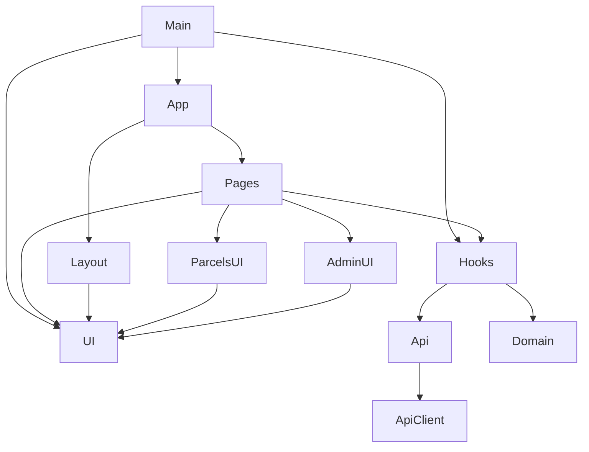

# ParcelFlow Frontend

Web client for the [ParcelFlow API](https://github.com/ALPHAMAN-0/ParcelFlowApi) — parcel delivery
management with three roles, a strictly linear status flow, and an append-only audit trail.

## Architecture / How it Works




A static single-page app: Vite 6, React 19, TypeScript, Tailwind CSS 4, React Router 7,
TanStack Query 5. No backend of its own — it talks to the API over HTTPS with a Bearer token.

- **Live API:** `https://parcelflowapi.onrender.com`
- **Deploys to:** Vercel (static `dist/`)

## Contents

- [Quick start](#quick-start)
- [Environment](#environment)
- [Deploying to Vercel](#deploying-to-vercel)
- [Connecting to the Render backend](#connecting-to-the-render-backend)
- [Demo accounts](#demo-accounts)
- [What each role can do](#what-each-role-can-do)
- [Project structure](#project-structure)
- [Notes on a few decisions](#notes-on-a-few-decisions)
- [Troubleshooting](#troubleshooting)

## Quick start

```bash
npm install
cp .env.example .env.local   # already points at the deployed API
npm run dev                  # http://localhost:5173
```

| Command | |
|---|---|
| `npm run dev` | Dev server with HMR |
| `npm run build` | Typecheck (`tsc -b`) then build to `dist/` |
| `npm run preview` | Serve the built `dist/` on :4173 |
| `npm run typecheck` | Types only |

To develop against a local API instead, set `VITE_API_BASE_URL=http://localhost:3000` in
`.env.local` and restart the dev server.

## Environment

One variable:

```
VITE_API_BASE_URL=https://parcelflowapi.onrender.com
```

No trailing slash, no path. **Vite inlines `VITE_*` at build time, not run time** — the value is
baked into the JS bundle, so changing it on Vercel needs a **redeploy**; saving the variable alone
does nothing.

Leaving it unset falls back to `/api`, the same-origin proxy described under
[Client-side blocking](#client-side-blocking).

The footer of every page shows the API host it resolved, with a live health dot — the quickest way
to confirm a deployment picked up the right value.

## Deploying to Vercel

This repo is the project root, so no "Root Directory" override is needed.

1. **Vercel → Add New → Project**, import `ALPHAMAN-0/parcelFlow_Frontend`.
2. Vercel detects Vite. Confirm the defaults:
   - Framework preset: **Vite**
   - Build command: `npm run build`
   - Output directory: `dist`
   - Install command: `npm install`
3. Under **Environment Variables**, add — for Production, Preview *and* Development:

   | Key | Value |
   |---|---|
   | `VITE_API_BASE_URL` | `https://parcelflowapi.onrender.com` |

4. **Deploy.**

`vercel.json` is committed and handles three things:

- **`/api/:path*` → the Render API.** Requests become first-party, so ad-blocker filter lists and
  enterprise URL-blocklist rules that target `onrender.com` no longer match them — and CORS stops
  applying at all. See [Client-side blocking](#client-side-blocking).
- **SPA fallback** (`/((?!api/).*)` → `/index.html`) so deep links like `/parcels/PF-YUH5F-P6VFX`
  reach `index.html` instead of 404ing — without it, every URL except `/` breaks on refresh. It
  excludes `/api` so it can never shadow the proxy, and it is listed *after* the proxy because the
  first matching rewrite wins.
- **cache headers:** `index.html` revalidates every time, `/assets/*` (content-hashed) is immutable
  for a year.

Keep that reasoning here rather than in the file: Vercel validates `vercel.json` against a strict
schema that rejects unknown keys, so a `"comment"` field inside a rewrite fails the build with
``The `vercel.json` schema validation failed`` — and plain JSON has no comment syntax either.

## Connecting to the Render backend

Nothing has to change on the API side. Set `VITE_API_BASE_URL` to the Render URL and redeploy.
Two reasons it just works:

**CORS is already open.** `ParcelFlowApi/src/app.js` uses bare `app.use(cors())`, so the API answers
`Access-Control-Allow-Origin: *`. A preflight from a `.vercel.app` origin returns `204` with
`Access-Control-Allow-Headers: content-type, authorization`.

**No cookies are involved.** Auth is an `Authorization: Bearer <jwt>` header and the client sends
`credentials: 'omit'`. A wildcard allow-origin forbids credentialed requests, so a cookie-based
client would have needed an API change; this one does not.

## Client-side blocking

Worth knowing about, because it cost real debugging time.

**EasyPrivacy** — on by default in Brave Shields, uBlock Origin and AdGuard — contains:

```
||onrender.com/health
```

`||` is a domain anchor covering every subdomain, so that rule blocks `/health` **and**
`/health/db` on any `*.onrender.com` host. The browser refuses the request itself
(`net::ERR_BLOCKED_BY_CLIENT`); nothing reaches the server, so no log shows it.

Two things follow:

- The footer's liveness probe therefore uses **`GET /`**, not `/health`. Same envelope, also never
  touches the database, and matches no rule in EasyList, EasyPrivacy or uBlock's lists. There is a
  comment saying so in `src/api/health.ts` — don't tidy it back.
- **The rest of the API was never affected.** The rules on this domain are path-scoped
  (`||onrender.com/health`, and `||onrender.com/api/ads/` in EasyList); there is no domain-wide
  block. `/auth/*`, `/parcels*` and `/admin/*` all pass. Login and every screen work with Shields up.

### If blockers ever target more than /health

`vercel.json` already carries an inert escape hatch:

```json
{ "source": "/api/:path*", "destination": "https://parcelflowapi.onrender.com/:path*" }
```

Switch `VITE_API_BASE_URL` to `/api` and redeploy. Every request then leaves the browser as
same-origin, so no filter list or corporate `URLBlocklist` can match it, and CORS stops applying
altogether. `vite.config.ts` mirrors the rewrite for local dev.

**It is not free, which is why it is not the default.** The API keys its rate limiter on
`cf-connecting-ip`, which Cloudflare sets to whoever connects *directly* — behind the proxy that is
Vercel's edge, not the visitor. All visitors then share one bucket:

| Limit | Direct | Proxied |
|---|---|---|
| Login | 10 / 15 min per visitor | 10 / 15 min **total** |
| Tracking lookup | 60 / min per visitor | 60 / min **total** |

Verified by probing: spoofing `x-forwarded-for` does not move the counter (`r=57 → r=56 → r=55`,
one continuous bucket) and `cf-connecting-ip` cannot be spoofed from outside — Cloudflare answers
403. Fixing it properly means changing the API's `keyGenerator`, which is out of scope here.

The clean alternative is a **custom domain** for the API (`api.yourdomain.com` → Render): filter
rules scoped to `onrender.com` stop matching *and* requests stay direct, so per-visitor limits
survive.

### Cold starts

Render's free tier spins a service down after roughly 15 minutes idle. The next request waits
30–60 seconds while it boots. The client handles this rather than failing:

- normal request timeout is 15s;
- on a network-level failure or a 502/503 it retries **once** with a 70s timeout;
- while that retry is in flight, an amber banner explains the wait.

Retries are deliberately limited to GETs and network failures. A `POST /parcels` is never retried —
that would risk creating two parcels — and a 409 or 422 is a real answer, not a blip.

### If you redeploy the API to a different URL

Change `VITE_API_BASE_URL` in Vercel, then **redeploy** (Deployments → ⋯ → Redeploy). Update
`.env.example` and `.env.local` for local work.

### Render service settings the API expects

For reference — nothing here is managed by this repo:

| Setting | Value |
|---|---|
| Build command | `npm install && npx prisma generate && npx prisma migrate deploy` |
| Start command | `npm start` |
| Node version | 22 (the API reads `.env` via `process.loadEnvFile()`) |
| Env vars | `NODE_ENV=production`, `DATABASE_URL`, `DIRECT_URL`, `JWT_SECRET`, `JWT_EXPIRES_IN`, `BCRYPT_ROUNDS`, optionally `REDIS_URL`, `SEED_*` |

`PORT` is injected by Render and read by `server.js`. Do not set it manually.

## Demo accounts

Seeded on the deployed database. The sign-in page fills these in on a click.

| Role | Email | Password |
|---|---|---|
| Admin | `admin@parcelflow.dev` | `admin123` |
| Delivery staff | `rahim.staff@parcelflow.dev` | `staff123` |
| Delivery staff | `karim.staff@parcelflow.dev` | `staff123` |
| Customer | `ayesha.customer@parcelflow.dev` | `customer123` |
| Customer | `tanvir.customer@parcelflow.dev` | `customer123` |

> These are published on the public landing page, **including the admin**, so anyone who opens the
> site can administer the demo database. That is usually what you want for a portfolio demo. To
> lock it down, edit `DEMO_ACCOUNTS` in `src/routes/pages/demoAccounts.ts` — drop the admin row, or
> empty the array to hide the panel entirely.

## What each role can do

| | Customer | Delivery staff | Admin |
|---|---|---|---|
| Sees | own parcels | assigned parcels | everything |
| Create a parcel | ✅ | — | ✅ |
| Advance status | — | ✅ own only | ✅ |
| Assign a courier | — | — | ✅ |
| Statistics, users | — | — | ✅ |

The status flow is strictly linear and `DELIVERED` is terminal:

```
PENDING → PICKED_UP → IN_TRANSIT → OUT_FOR_DELIVERY → DELIVERED
```

Because there is at most one legal next status from any state, the UI offers a single
"Mark <next>" button rather than a status picker — a dropdown of five would be four guaranteed
409s. `DELIVERED` gets a confirmation dialog, since it cannot be undone.

The route guards here are for navigation, not security. The API re-checks the role on every
request and scopes every query in SQL, so bypassing the client gets you a 403 or an empty list.
A parcel outside your scope returns **404, not 403** — a 403 would confirm it exists — and the UI
phrases it as "not found, or not visible to your account".

## Project structure

```
src/
  lib/        apiClient.ts   the only module that knows HTTP or the response envelope
              ApiError.ts    typed errors carrying code + details + requestId
              errorMessages.ts  every API error code → copy a user can act on
              config.ts  format.ts  storage.ts  queryKeys.ts  cn.ts
  domain/     parcelStatus.ts   mirrors the API's transition table
              trackingCode.ts   mirrors the API's code format + alphabet
  types/      api.ts       transcribed from the API's Prisma selects
  api/        auth.ts  parcels.ts  admin.ts  health.ts
  hooks/      useAuth.tsx  useParcels.ts  useAdmin.ts  useToast.tsx
              useTheme.tsx  useApiHealth.ts  useDebounced.ts
  components/ layout/  ui/  parcels/  admin/
  routes/     guards.tsx  pages/
```

`src/domain/` deliberately duplicates two small API modules. Each file names its counterpart in a
header comment. The API remains the authority — it re-validates everything — but the copy lets the
UI offer only legal actions and reject a malformed tracking code without spending a request.

## Notes on a few decisions

**Empty query params are dropped, not sent.** Every API schema is a Zod `strictObject`, so
`GET /parcels?status=` is a hard `422` rather than "no status filter". `buildQueryString()` in
`apiClient.ts` omits `undefined`, `null` and `''`, which is what keeps an unset filter from
breaking the page. Same reason `?search=` is omitted when the box is empty.

**Detail pages are keyed by tracking code, not id.** `GET /parcels/:trackingCode` is the API's
catch-all for any single-segment GET, so `GET /parcels/<uuid>` returns a 422, not a parcel. That one
request also returns the full history, so the detail page needs exactly one call.

**A 401 does not always mean the session died.** `INVALID_CREDENTIALS` is a 401 too, but it means a
wrong password on the login form. The client only ends the session for `TOKEN_MISSING`,
`TOKEN_EXPIRED`, `TOKEN_INVALID` and `USER_NOT_FOUND` — otherwise a mistyped password would bounce
the user off the page they were trying to use.

**Password minimum is 1, not 8.** The API's README says 8, but `auth.schemas.js` is `min(1)`.
Gating at 8 in the client would lock out the seeded demo logins. The max of 72 is real: bcrypt
ignores anything past 72 bytes, so two different long passwords could unlock one account.

**Counts come from `meta.total`.** The customer and staff dashboards issue five
`GET /parcels?limit=1&status=X` reads and read `meta.total` from each. Five small requests, but
exact — and `/parcels` is not rate limited, unlike the tracking endpoint (60/min).

**No charts library.** The statistics bars are ~40 lines of CSS and SVG. A charting dependency
would have added tens of kilobytes to draw five rows whose lengths are one division each.

**Session is `localStorage` + revalidation.** The token and a cached user paint the app instantly
on reload; `GET /auth/me` then confirms it. The API re-reads the user from the database on every
request, so a role change an admin made while the tab was closed applies immediately. A network
failure during that check keeps the cached session rather than signing the user out over a blip.

## Troubleshooting

| Symptom | Cause |
|---|---|
| `net::ERR_BLOCKED_BY_CLIENT` on `/health` | Expected with Brave Shields / uBlock / AdGuard: EasyPrivacy blocks `||onrender.com/health`. The probe now uses `GET /` instead, so this should no longer appear. See [Client-side blocking](#client-side-blocking). |
| `ERR_BLOCKED_BY_CLIENT` on `/auth` or `/parcels` too | A blocker is targeting more than the health paths. Switch `VITE_API_BASE_URL` to `/api` and redeploy. |
| Footer shows the wrong host on a deployed build | `VITE_API_BASE_URL` changed but the build did not. **Redeploy** — saving the variable alone is not enough, Vite inlines it at build time. |
| First request after idle takes ~a minute | Render free-tier cold start. The amber banner is expected; it resolves itself. |
| Refreshing `/parcels/PF-…` 404s | The SPA rewrite in `vercel.json` is not being applied. Confirm the file is committed and the output directory is `dist`. |
| `/api/...` returns Vercel's 404 page | The `/api/:path*` rewrite is missing or listed *after* the SPA fallback. The first matching rewrite wins, so it must come first. |
| "Too many sign-in attempts" | The API allows 10 logins per 15 minutes per IP. Wait it out. |
| Every filter returns a validation error | Something is serialising empty params. Filters must be omitted when blank, not sent as `''`. |
